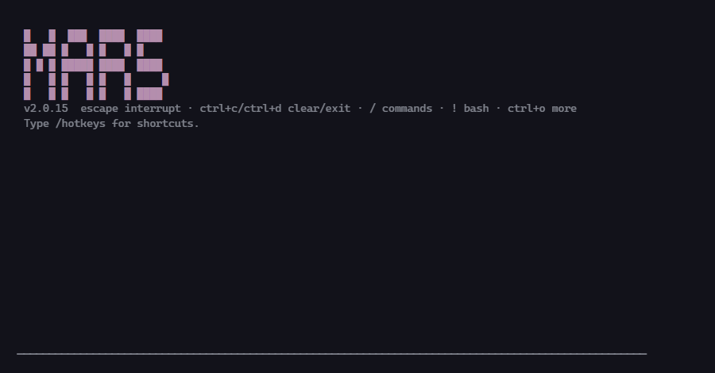
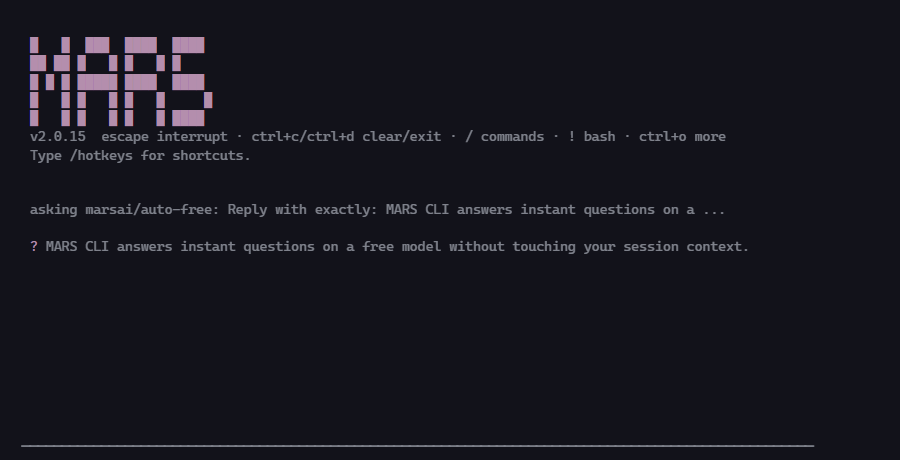
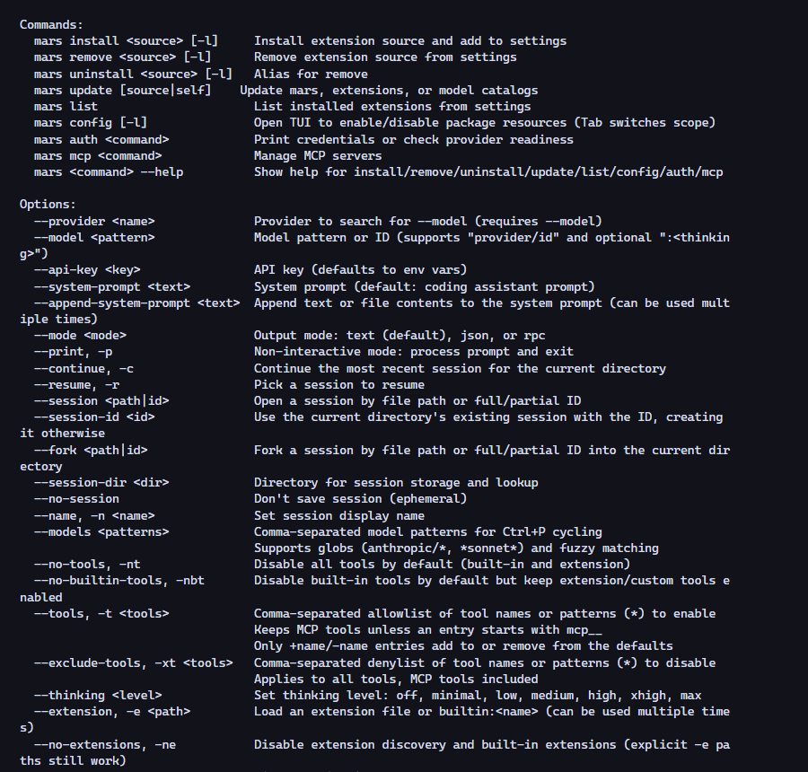

<div align="center">


# MARS CLI

**A fast, terminal-native AI coding agent — powered exclusively by MarsAI.**

[](https://www.npmjs.com/package/@mars_ai/marscli)
[](https://www.npmjs.com/package/@mars_ai/marscli)
[](LICENSE)
[]()

</div>

---

MARS CLI (`mars`) is a coding agent that lives in your terminal. It reads, writes, and runs code in your project, plans multi-step work with subagents, and answers quick questions on a **free model** without touching your session context. One provider, one login: [MarsAI](https://marsai.click).

## Screenshots

<table>
  <tr>
    <td align="center"><br/><sub>Startup header</sub></td>
    <td align="center"><br/><sub>Free-model <code>?</code> ask</sub></td>
  </tr>
</table>

<details>
<summary><code>mars --help</code></summary>

</details>

## Features

- **MarsAI-only provider** — sign in with OAuth device flow (`/mars`) or `MARSAI_API_KEY`. No provider zoo to configure.
- **Free-tier delegation** — inline `?question`, `/ghost` (replay last prompt), `/budget`, subagents, and auto-recon all run on `marsai/auto-free` at zero cost, isolated from your main session context.
- **Subagents** — single, parallel, and chained dispatch to isolated child `mars` processes, each with its own context window. Explore-first auto-recon appends a repo map to the system prompt on the first turn of a fresh session.
- **Web tools** — `web_fetch` (manual-redirect fetching with per-hop private-network blocking) and `web_search` (DuckDuckGo lite).
- **`/handoff`** - export a session as JSONL with copy-paste import instructions; move work between machines or teammates.
- **`/init`** - generate or improve `AGENTS.md`: collects project stats (manifests, scripts, workspaces, file counts), then the agent investigates the repo and writes the instruction file itself.
- **`mars pack`** - export tracked files as XML context for handoff to another model. Gitignore-aware, skips binaries, redacts secrets, caps output at 200KB.
- **`/update`** - self-update from the npm registry, async and non-blocking.
- **Sessions, themes, MCP, codemode** — resumable sessions, themable TUI, MCP server support, and JavaScript code mode.
- **Safe by default** — trust dialogs for project folders, SSRF-protected redirects, SIGTERM→SIGKILL child process escalation.

## Install

```bash
npm install -g @mars_ai/marscli
```

Requires Node.js >= 22.19.

## Quickstart

```bash
cd your-project
mars
```

First run: sign in via `/mars` (OAuth device flow) or export `MARSAI_API_KEY`. Then just type what you want built.

Handy keys:

| Input | Effect |
| --- | --- |
| `?question` | Ask a free model without touching session context |
| `/ghost` | Replay the last prompt on the free model |
| `/init [focus]` | Create or improve `AGENTS.md` (focus text optional) |
| `!cmd` | Run a shell command inline |
| `ctrl+o` | Expand the transcript |
| `/handoff` | Export the session as JSONL |

Non-interactive:

```bash
mars -p "refactor server.js to use ES modules"   # one-shot prompt
mars --mode json -p "list dead exports"           # JSON output
mars pack                                         # repo as XML for another model
mars pack --query "src/**/*.ts" --max-bytes 100000
mars pack --full                                  # no size cap
```

## Configuration

| Env var | Purpose |
| --- | --- |
| `MARSAI_API_KEY` | MarsAI API key (alternative to OAuth login) |
| `MARSAI_SUBAGENT_MODEL` | Pin the model used for free-tier delegation |
| `MARS_NO_RECON` | Set `1` to disable auto-recon in spawned children |

Settings live in `.mars/` (project) and `~/.mars/` (global).

## Documentation

- [Extensions guide](packages/coding-agent/docs/extensions.md)
- [Examples](packages/coding-agent/examples/)
- [`mars --help`](#screenshots)

## License

[MIT](LICENSE) — forked from [mars](https://github.com/earendil-works/pi) by Mario Zechner. Rebranded and maintained as MARS CLI with the MarsAI provider.
